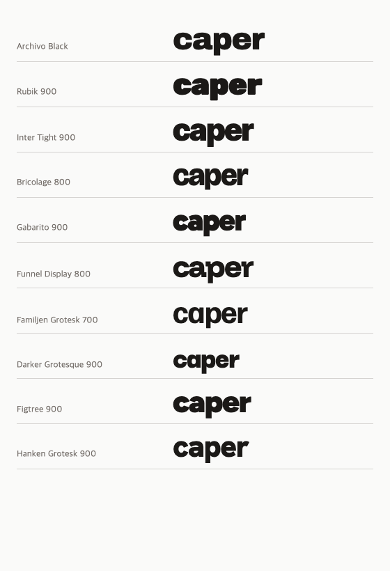
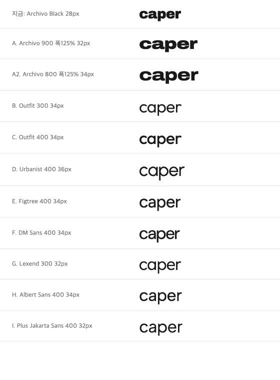

# 로고 글꼴

헤더 로고는 소문자 `caper` 를 Urbanist 400 으로 쓴다(36px, 자간 -0.01em).
본문·제목 글꼴(Pretendard)과 따로, 로고에만 쓴다.

## 고른 과정 (2026-10-21)

1. 처음에는 mangrove 로고 같은 아주 굵은 소문자를 찾았다. 굵은 글꼴 열 가지를
   같은 줄에 그려 Archivo Black 을 골랐다(#46).

   

2. 더 크고 넓게 하고 싶어 폭 축이 있는 Archivo(폭 125%·900)로 바꿨다(#58). CSS
   로 가로를 늘리면 획이 찌그러지므로 쓰지 않는다.
3. eyesmag 로고 같은 얇은 기하 글꼴 후보를 함께 그려 비교했고, D(Urbanist 400)를
   골랐다(#60).

   

## 싣는 방식

- 가변 글꼴 전체(굵기 축)를 받지 않고, Google Fonts 에서 굵기 400·라틴만 잘라
  받은 정적 woff2(12KB)를 `src/app/fonts/` 에 두고 `next/font/local` 로 싣는다.
- 라이선스: SIL Open Font License 1.1(`NOTICE`).
- 글꼴을 바꿀 때는 같은 방식으로 후보를 한 장에 그려 비교하고, 이 문서와
  이미지를 고친다.
